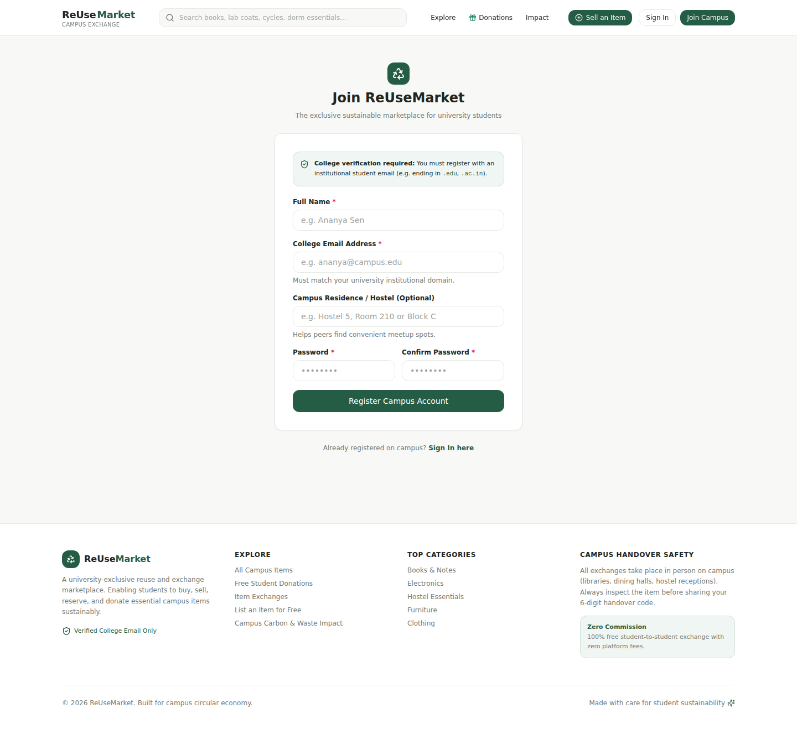
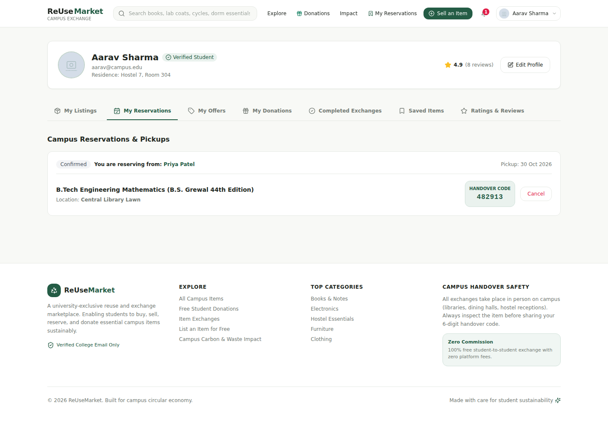
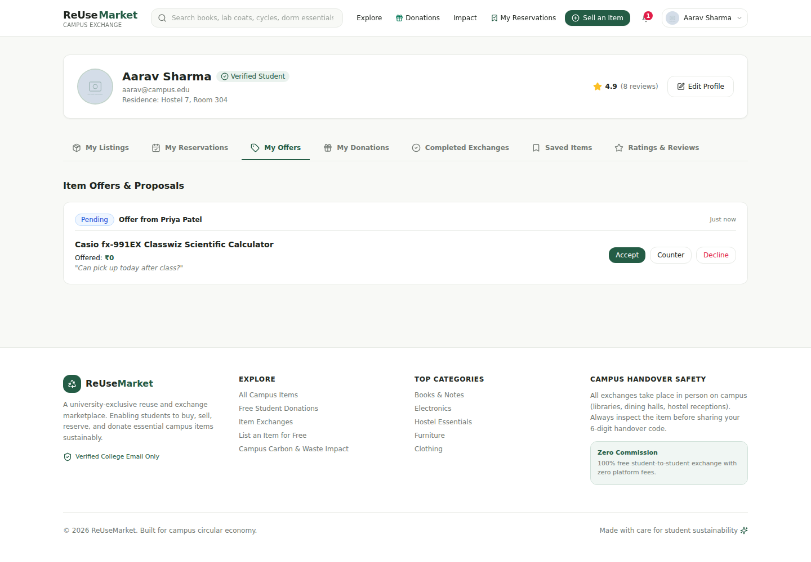
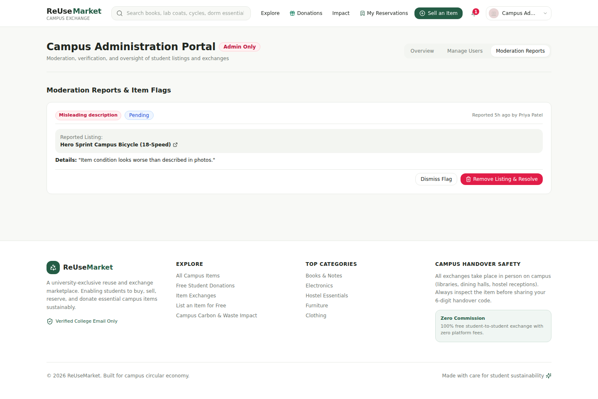

# ♻️ ReUseMarket --- Campus Reuse & Exchange Platform

**ReUseMarket** is a campus-focused marketplace where university
students can buy, sell, reserve, exchange, and donate pre-owned
essentials. It encourages affordable student-to-student exchanges and
helps reduce waste by giving useful items a second life.

> **Project goal:** Make campus exchanges safer, more convenient, and
> more sustainable --- with no platform commission and in-person campus
> handovers.

## 🌐 Live Demo

- **Live website:** https://re-use-market-three.vercel.app
- **Backend API:** https://reusemarket.onrender.com
- **API health check:** https://reusemarket.onrender.com/api/health
- **GitHub repository:** https://github.com/GAJJAR-DAKSH/ReUseMarket

The frontend is deployed on Vercel, the Express API is hosted on Render, and the application database uses MongoDB Atlas. The API health endpoint can be used to confirm that the backend is responding.

> Note: Render's free service may sleep after inactivity. Also verify that uploaded images use persistent/cloud storage before relying on them long-term; files stored on a local server disk may not persist across redeploys.

## ✨ Features

-   **Campus-focused marketplace** for books, notes, electronics, hostel
    essentials, furniture, clothing, stationery, and sports equipment.
-   **Student registration and authentication** with college
    email-domain validation.
-   **Search, filters, and sorting** to help students discover relevant
    listings.
-   **Create and manage listings**, including price, condition,
    description, pickup location, and item photos.
-   **Offers and exchanges** with accept, decline, and counter-offer
    actions.
-   **Reservations and secure handover** using a six-digit handover
    code.
-   **Donations** for items students want to give away for free.
-   **Saved items** so users can revisit favourites.
-   **Ratings and reviews** after completed exchanges.
-   **Sustainability dashboard** showing estimated emissions avoided,
    waste diverted, student savings, and items circulated.
-   **Admin portal** for overview metrics, user management, and
    moderation reports.
-   **Responsive interface** with a clean, campus-friendly design.

## 🖥️ Screenshots

Place the supplied screenshots in a folder named `screenshots/` at the
repository root, keeping these filenames. If you use different
filenames, update the paths below.

### Home and marketplace

  ----------------------------------------------------------------------------------
  Landing page                        Marketplace
  ----------------------------------- ----------------------------------------------
     marketplace](screenshots/02-marketplace.png)

  ----------------------------------------------------------------------------------

### Listing details and sustainability

  ----------------------------------------------------------------------------------------------
  Product details                                Sustainability analytics
  ---------------------------------------------- -----------------------------------------------
     dashboard](screenshots/04-sustainability.png)

  ----------------------------------------------------------------------------------------------

### Authentication

  ----------------------------------------------------------------------------------
  Sign in                             Join campus
  ----------------------------------- ----------------------------------------------
  
  in](screenshots/05-login.png)       

  ----------------------------------------------------------------------------------

### Student dashboard

  -----------------------------------------------------------------------------------------------------------------
  My listings                                         Reservations
  --------------------------------------------------- -------------------------------------------------------------
  
  listings](screenshots/08a-dashboard-listings.png)   

  -----------------------------------------------------------------------------------------------------------------

  -----------------------------------------------------------------------------------------------
  Offers                                            Saved items
  ------------------------------------------------- ---------------------------------------------
     

  -----------------------------------------------------------------------------------------------

  -----------------------------------------------------------------------------------------------
  Ratings and reviews                               Create a listing
  ------------------------------------------------- ---------------------------------------------
     listing](screenshots/09-create-listing.png)

  -----------------------------------------------------------------------------------------------

### Campus administration

  -----------------------------------------------------------------------------------------
  Admin overview                                  Manage users
  ----------------------------------------------- -----------------------------------------
     users](screenshots/10b-admin-users.png)

  -----------------------------------------------------------------------------------------



## 🧰 Tech Stack

**Frontend** - React 18 - Vite - Tailwind CSS - React Router - Axios -
Lucide React

**Backend** - Node.js - Express - JSON Web Tokens (JWT) - bcryptjs -
Multer

**Database** - MongoDB with Mongoose - Can be configured to use MongoDB
Atlas or a local MongoDB instance

## 📁 Project Structure

``` text
ReUseMarket/
├── client/                 # React + Vite frontend
│   ├── src/
│   ├── public/
│   ├── package.json
│   └── vite.config.js
├── server/                 # Express API
│   ├── config/
│   ├── controllers/
│   ├── middleware/
│   ├── models/
│   ├── routes/
│   ├── services/
│   ├── utils/
│   ├── uploads/
│   ├── .env.example
│   ├── server.js
│   └── package.json
├── package.json
└── README.md
```

## 🚀 Getting Started

### Prerequisites

-   Node.js (recommended: current LTS version)
-   npm
-   MongoDB Atlas connection string or a local MongoDB instance

### 1. Clone the repository

``` bash
git clone https://github.com/GAJJAR-DAKSH/ReUseMarket.git
cd ReUseMarket
```

### 2. Install dependencies

``` bash
cd server
npm install
cd ../client
npm install
cd ..
```

### 3. Configure environment variables

Create `server/.env` using `server/.env.example` as a template:

``` env
PORT=5000
NODE_ENV=development
MONGODB_URI=mongodb://127.0.0.1:27017/reusemarket
JWT_SECRET=replace_with_a_long_random_secret
CLIENT_URL=http://localhost:5173
ALLOWED_COLLEGE_EMAIL_DOMAIN=.edu,.ac.in,campus.edu
IMAGE_STORAGE_PROVIDER=local
```

Update the values for your environment. Use a strong, private JWT secret
and your own database credentials. **Never commit `.env` files or
production secrets to GitHub.**

### 4. Start the application

Open two terminals from the repository root.

**Terminal 1 --- backend**

``` bash
cd server
node server.js
```

**Terminal 2 --- frontend**

``` bash
cd client
npm run dev
```

Open the local URL printed by Vite (usually `http://localhost:5173`).
The API typically runs on `http://localhost:5000`.

> The frontend must be configured to send API requests to the backend
> URL. For deployment, configure the production API URL and CORS
> settings for your deployed frontend domain.

## 🔐 Security and deployment notes

-   Keep `.env` files, database credentials, JWT secrets, and private
    keys out of version control.
-   Restrict college email domains to the intended institution for a
    real deployment.
-   Configure CORS to allow only trusted frontend origins.
-   For production, use persistent database storage and durable/cloud
    image storage. Local uploads and in-memory fallback data may not
    persist across redeploys or restarts.
-   Demo accounts or seed data should be used only in development and
    should never retain default passwords in production.

## 🌱 Sustainability and campus safety

ReUseMarket supports reuse by helping students circulate items that
might otherwise be discarded. Sustainability figures are estimates based
on the application's configured assumptions, not independently verified
measurements. Users should inspect items and complete handovers in a
public campus location.

## 🛣️ Future Improvements

-   Cloud image storage
-   Email verification and password-reset delivery
-   Automated deployment checks and monitoring
-   Automated tests and CI checks
-   Improved accessibility and mobile navigation
-   More detailed analytics and moderation audit logs

## 👤 Author

**Daksh Gajjar**

GitHub: [@GAJJAR-DAKSH](https://github.com/GAJJAR-DAKSH)

## 📄 License

This project currently uses the license declared in the repository's
`package.json` (`ISC`). Add a `LICENSE` file if you want the license
terms to be explicitly included in the repository.